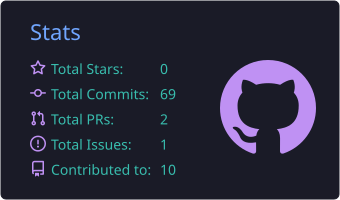

# Hey, I'm Kutay Onur 👋

**Computer Science Student · Full-Stack, Desktop & Multiplayer Web Developer**  
📍 Warsaw, Poland · 🌐 [kutayonur.dev](https://kutayonur.dev) · 🎲 [mezarpoly.fun](https://mezarpoly.fun) · ☕ [mezarcafe.com](https://mezarcafe.com) · ✨ [twinely.net](https://twinely.net)

---

### 🧑‍💻 About Me

- 🎓 Computer Science student in **Warsaw, Poland**
- 🛠️ Building **real-time multiplayer browser games**, **desktop & web apps (Svelte + Tauri / Rust, PyQt6)**, **web backends**, and **self-hosted Linux/Docker services**
- 🌐 Running **[kutayonur.dev](https://kutayonur.dev)**, **[twinely.net](https://twinely.net)**, **[mezarpoly.fun](https://mezarpoly.fun)**, and **[mezarcafe.com](https://mezarcafe.com)**

---

### 🚀 Featured Projects

#### Live & Private Projects
| Project | Description | Stack |
| :--- | :--- | :--- |
| **[Mezarpoly · Mezar Café](https://mezarpoly.fun)** | Real-time multiplayer browser monopoly & card games (Blöf, Hortlak) — live at [mezarpoly.fun](https://mezarpoly.fun) & [mezarcafe.com](https://mezarcafe.com) | `JavaScript` `Python` `Docker` |
| **[Twinely](https://twinely.net)** | Cross-platform application built with modern reactive UI and native Rust backend — live at [twinely.net](https://twinely.net) | `Svelte` `Rust` `Tauri` `TypeScript` |

#### Public Repositories
| Project | Description | Stack |
| :--- | :--- | :--- |
| **[mezarbot](https://github.com/kutyfuty/mezarbot)** | Self-hosted Discord bot with stutter-free music & SoundCloud fallback, private voice rooms, moderation, voice stats, and AI (TR/EN) | `Python` `Docker` `AI` |
| **[discord-music-bot](https://github.com/kutyfuty/discord-music-bot)** | Self-hosted music-only Discord bot supporting YouTube, Spotify, SoundCloud, live lyrics, and dual voice channels | `Python` `Audio` `Self-Hosted` |
| **[ultimate-web-cloner](https://github.com/kutyfuty/ultimate-web-cloner)** | Offline website cloner with desktop GUI | `Python` `PyQt6` `Playwright` |
| **[Youtube-Video-Downloader](https://github.com/kutyfuty/Youtube-Video-Downloader)** | Web app for downloading YouTube videos as MP4 or MP3 | `Python` `Flask` `yt-dlp` |

---

### 🧰 Tech Stack

**Languages**  

**Frameworks, Desktop & Automation**  

**Infrastructure & Tools**  

---

### 📊 GitHub Activity

