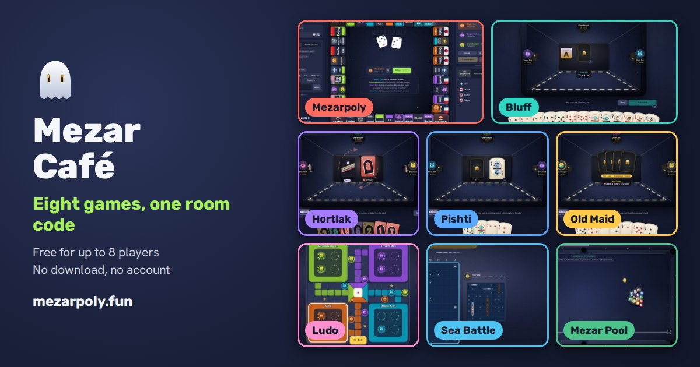
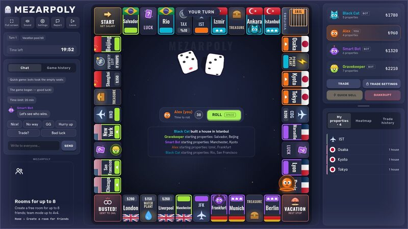
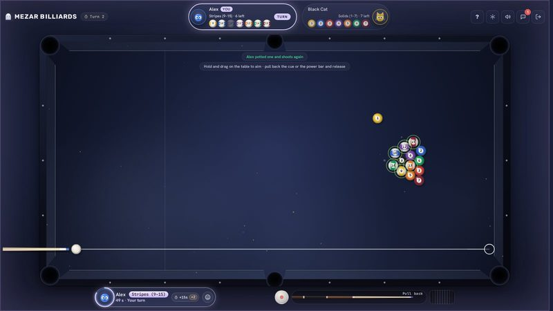
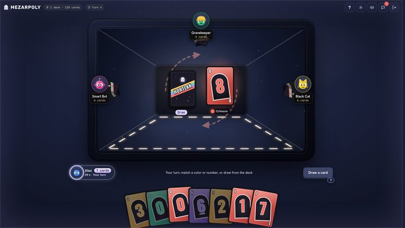
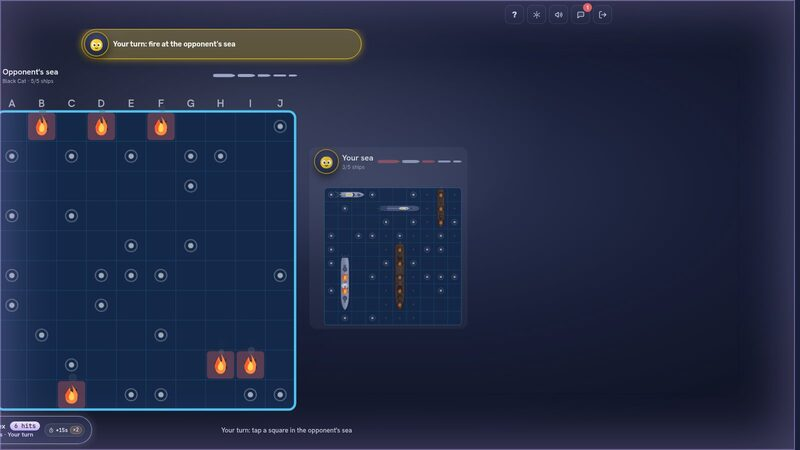
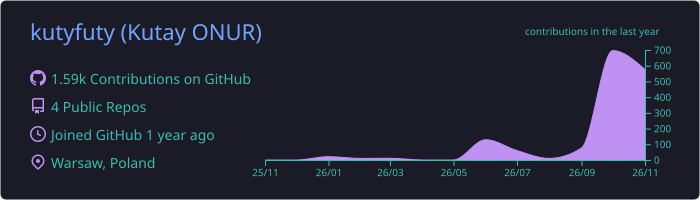
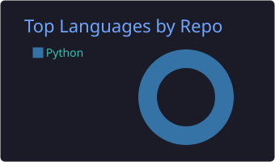

<div align="center">

<a href="https://kutayonur.dev"></a>

<br>

[](https://kutayonur.dev)
[](https://mezarcafe.com)
[](https://twinely.net)
[](mailto:kutay@kutayonur.dev)

</div>

## 👋 About me

```js
const kutay = {
  location:  "Warsaw, Poland 🇵🇱",
  studying:  "Computer Science",
  building:  ["real-time multiplayer games", "desktop apps", "Discord bots", "self-hosted services"],
  favorite:  "shipping things people actually use",
  languages: ["Türkçe", "English"],
};
```

## ☕ Mezar Café — my main project

<a href="https://mezarcafe.com"></a>

**[mezarcafe.com](https://mezarcafe.com)** is a browser game café I build and run on my own: **eight real-time multiplayer games**, free rooms for up to 8 players, no download, no account needed. One room code, and your friends are in.

<table>
  <tr>
    <td width="50%"><br><div align="center"><b>Mezarpoly</b> · property trading board game</div></td>
    <td width="50%"><br><div align="center"><b>Mezar Pool</b> · 8-ball with a hand-written physics engine</div></td>
  </tr>
  <tr>
    <td width="50%"><br><div align="center"><b>Hortlak</b> · fast colour-matching card game</div></td>
    <td width="50%"><br><div align="center"><b>Sea Battle</b> · classic fleet hunt for two</div></td>
  </tr>
</table>

<details>
<summary><b>🔧 Under the hood</b></summary>
<br>

- **Server-authoritative** game engine in Python (asyncio, aiohttp, WebSockets): every move is checked on the server, clients only render
- Bots with three difficulty levels and human-like pacing, so a room is never empty
- Vue + Three.js client (3D dice), built for **phones first** (tested on 360–390 px screens and iPhone WebKit)
- 2D billiards physics: sliding/rolling friction, spin, cushion jaws and pocket mouths
- Stripe payments, Google/Discord login, passkeys for the admin panel, nightly encrypted off-site backups
- Runs on a single free-tier ARM server behind a Cloudflare Tunnel, with an end-to-end Playwright test suite running every night

</details>

## 🚀 Other projects

| | Project | What it is | Stack |
|:-:|:--|:--|:--|
| ✨ | **[Twinely](https://twinely.net)** | Cross-platform app with a reactive UI and a native Rust backend | `Svelte` `Rust` `Tauri` `TypeScript` |
| 🪦 | **[mezarbot](https://github.com/kutyfuty/mezarbot)** | Self-hosted Discord bot: stutter-free music, private voice rooms, moderation, voice stats, AI (TR/EN) | `Python` `Docker` |
| 🎵 | **[discord-music-bot](https://github.com/kutyfuty/discord-music-bot)** | Music-only Discord bot: YouTube, Spotify, SoundCloud, live lyrics, two voice channels at once | `Python` `FFmpeg` |

## 🧰 Tech stack

<div align="center">

<br><br>
<br><br>


</div>

## 📊 GitHub activity

<div align="center">







</div>

<div align="center">
<sub>👻 Come play a round at <a href="https://mezarcafe.com">mezarcafe.com</a></sub>
</div>
